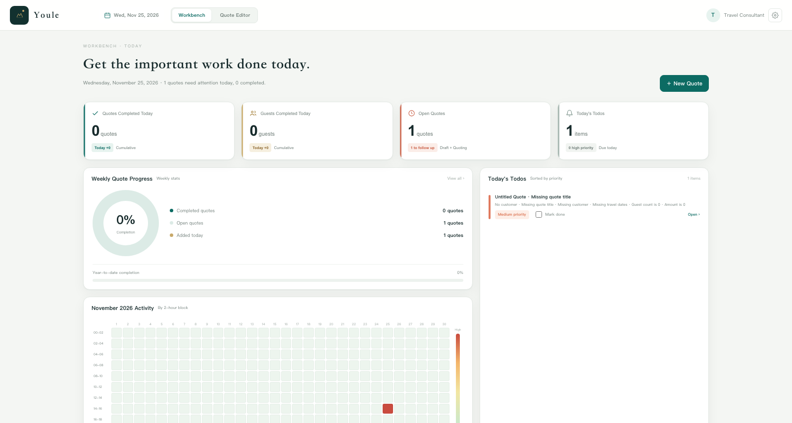
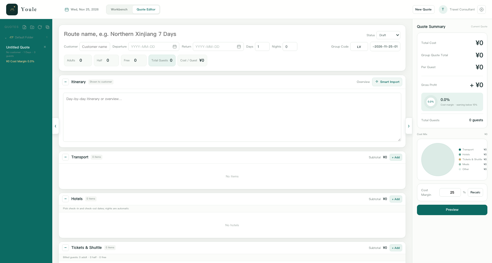

[English](https://github.com/flyLLiu/travel-quote-se/blob/main/README.en.md) | [简体中文](https://github.com/flyLLiu/travel-quote-se/blob/main/README.md)

# Youle · Travel Quote

A local-first travel quotation app for DeepSeek Harness. It opens from the DSH sidebar and keeps quote data in the local browser.

## Screenshots

**Workbench**



**Quote Editor**



## Features

- Local quote management
- Folder organization
- Itinerary parsing
- Cost and margin calculation
- Single-window protection
- Customer preview
- Word, Excel and PDF export
- Chinese and English interface

## Install

```bash
npm install travel-quote
```

Open **youle-se** from the DSH sidebar, or run:

```text
/tqse
```

App URL:

```text
http://127.0.0.1:17866/
```

## Language

The interface follows the system language by default:

```text
Chinese system → 简体中文
Other systems  → English
```

Change it in:

```text
Settings → Appearance → Language
```

## Data

Quote data stays in the local browser. The app starts with empty data.

## License

AGPL-3.0-only.
