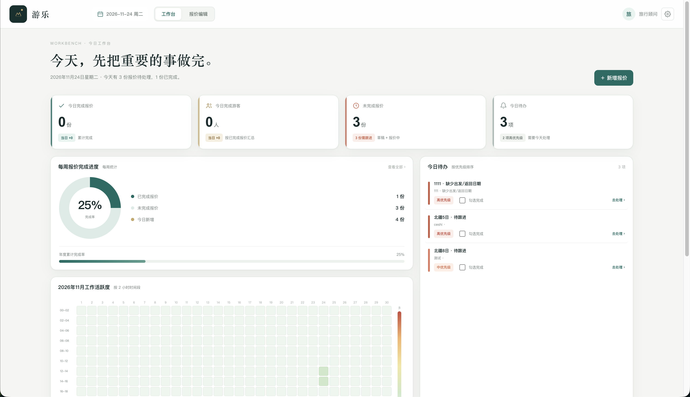
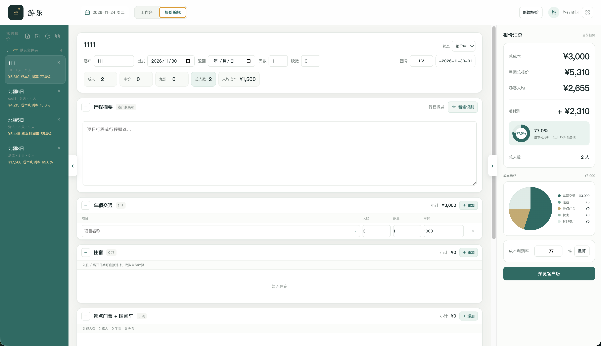
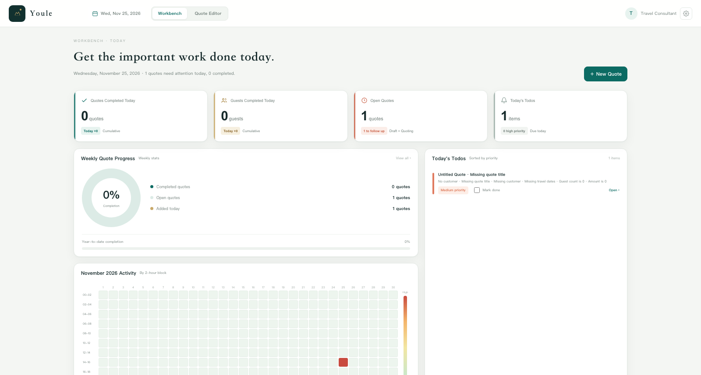
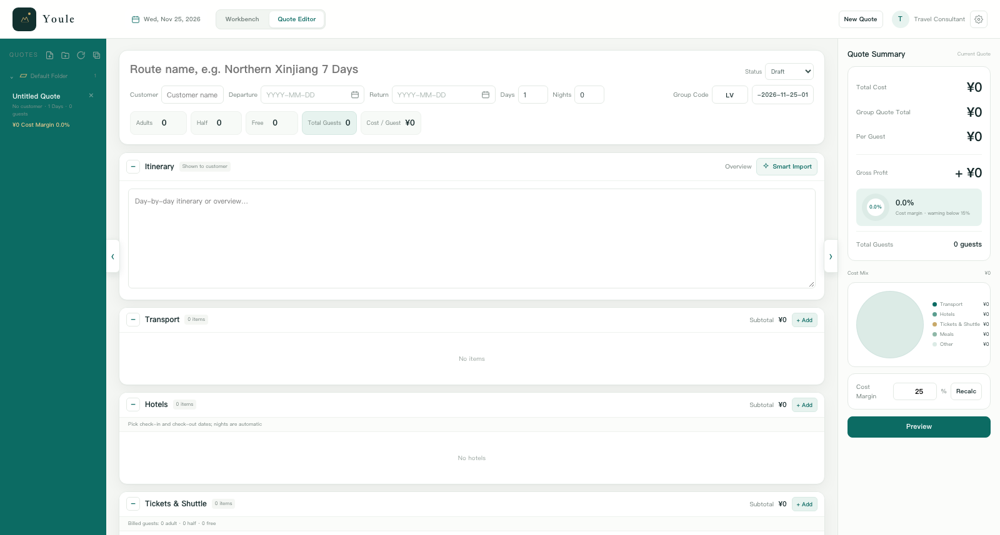

# Youle · Travel Quote / 游乐 · 旅行报价

本地优先的旅游报价应用，可作为 DSH 插件在侧边栏打开。

A local-first travel quotation app for DeepSeek Harness.

## 界面预览 / Screenshots

**工作台 / Workbench**



**报价编辑 / Quote Editor**



**工作台（英文）/ Workbench (English)**



**报价编辑（英文）/ Quote Editor (English)**



## 功能 / Features

- 本地报价管理 / Local quote management
- 文件夹整理 / Folder organization
- 行程识别 / Itinerary parsing
- 成本与利润率计算 / Cost and margin calculation
- 单窗口保护 / Single-window protection
- 客户版预览 / Customer preview
- Word、Excel、PDF 导出 / Word, Excel and PDF export
- 中英文界面 / Chinese and English interface

## 安装 / Install

```bash
npm install travel-quote
```

安装后点击 DSH 侧边栏「游乐-se」，或使用 DSH 命令：

```text
/tqse
```

After installation, open **youle-se** from the DSH sidebar, or run `/tqse`.

应用地址 / App URL：

```text
http://127.0.0.1:17866/
```

## 语言 / Language

界面语言默认跟随系统语言：

```text
中文系统 → 简体中文
其他系统 → English
```

可在设置中切换：

```text
Settings → Appearance → Language
```

The interface follows the system language by default. You can change it in Settings.

## 数据 / Data

报价数据仅保存在当前浏览器，从空数据开始。

Quote data stays in the local browser. The app starts with empty data.

## 许可 / License

AGPL-3.0-only.
